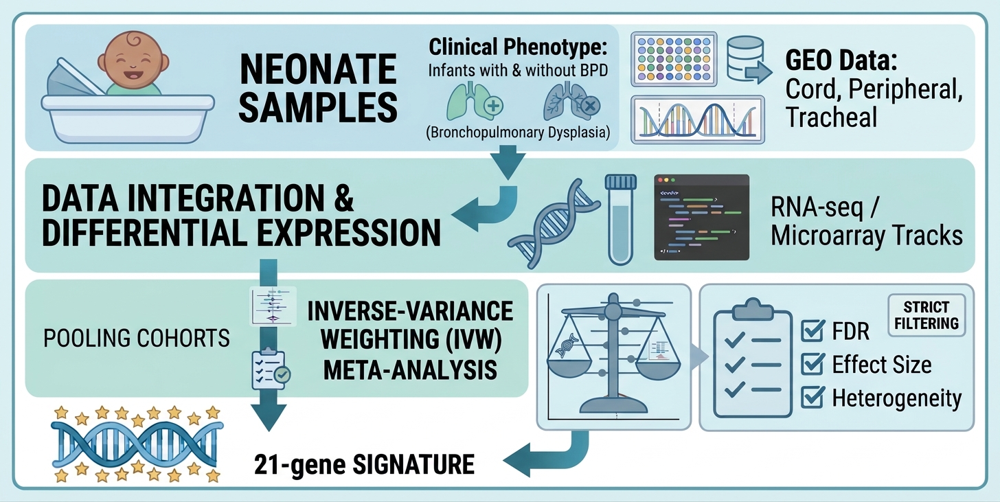

# Conserved Biological Programs Associated with Bronchopulmonary Dysplasia Across Early Life

  

## Overview

Bronchopulmonary dysplasia (BPD) is a major complication of prematurity associated with aberrant alveolar and vascular development of the lungs resulting in impaired gas exchange[1]. Understanding the biological processes associated with BPD across early life may help characterize disease-associated molecular patterns, clinical phenotypes, and identify molecular architectures that will help in the development of effective therapies and impact the incidence of BPD.

This project integrates publicly available neonatal transcriptomic datasets to investigate conserved gene-expression patterns associated with BPD across independent cohorts, assay platforms, and tissue sources. This analysis combines cohort-specific differential gene-expression analysis, cross-study meta-analysis, biological pathway characterization, and longitudinal modeling to examine shared molecular signals and their temporal patterns.

The primary objectives are to:
- Identify genes with reproducible BPD-associated expression patterns across independent neonatal cohorts.
- Characterize conserved transcriptomic signals using complementary meta-analytic approaches.
- Investigate biological programs associated with metabolism, innate immune activation, vascular dysfunction, and structural remodeling.
- Evaluate a compact 21-gene BPD-associated transcriptomic signature across microarray and RNA-sequencing datasets.
- Examine longitudinal patterns in selected biological pathways using neonatal cohorts with repeated measurements.

The 21-gene signature is intended as an exploratory molecular signal for further investigation, rather than a clinically validated early diagnostic or predictive assay. 

## Study Design and Data Sources

The study integrates seven publicly available gene expression datasets available from National Center for Biotechnology Information (NCBI) Gene Expression Omnibus (GEO) database and spans four countries: the United States, Norway, Germany, and Australia.

| Study characteristic | Description |
|--------------|---------------|
| Independent cohorts | 7  |
| Total samples | 764  |
| Total infants | 426 |
| Microarray cohorts | 4 cohorts; 437 samples |
| RNA-sequencing cohorts | 3 cohorts; 327 samples |
| Tissue sources | Cord blood, peripheral blood, and lung tissue |
| Longitudinal cohorts | GSE32472 and GSE220135 |

## Included cohorts

The analysis uses the following GEO datasets:
- GSE8586
- GSE32472
- GSE188944
- GSE225881
- GSE106910
- GSE125873
- GSE220135

The discovery analysis focuses on samples collected during the first week of life. Two cohorts, GSE32472 and GSE220135, also contribute longitudinal data for investigating the temporal behavior of selected biological pathways.

## Definitions of BPD
| Author and Year | Definition |
|-----------------|------------|
| Shennan et al, 19884 | Use of supplemental oxygen at 36 weeks PMA |
| NIH consensus, 20015 | Oxygen use for 28 days (not consecutive), with severity based on amount of supplemental oxygen and mode of respiratory support at 36 weeks PMA; mild (room air), moderate (< 30% supplemental oxygen), severe (⪰ 30% supplemental oxygen and/or positive pressure) |
| Walsh et al, 20046 | Receipt of positive pressure or supplemental oxygen at 36 weeks PMA. In infants receiving ≤ 30% oxygen via blood or nasal cannula, a stepwise room air challenge test is performed. Failure of the room air challenge, or need for mechanical ventilation and/or positive pressure are classified as BPD |
| Isayama et al, 20177 | Use of oxygen and/or respiratory support (including invasive and non-invasive support) at 40 weeks PMA |
| NICHD workshop, 2018 | Supplemental oxygen or positive pressure at 36 weeks PMA along with radiographic evidence of parenchymal lung disease, irrespective or prior duration of oxygen supplementation. Incorporates 3 grades of severity depending on levels of supplemental oxygen and mode of support |
| Jensen et al, 20198 | Any respiratory support at 36 weeks PMA, irrespective of prior duration or current level of oxygen therapy. Further categorized according to disease severity: grade 1, nasal cannula at flow rates ≤ 2L/min; grade 2, nasal cannula at flow rates > 2L/min or non-invasive positive airway pressure; and grade 3, invasive mechanical ventilation |

## BPD definitions by study
| Study GSE | Definition |
|-----------|------------|
| GSE85869 | Persistent oxygen requirement at 36 weeks' PMA |
| GSE3247210 | Mild BPD; need for supplemental oxygen for > or =28 days, but not 36 weeks' PMA or discharge. Moderate BPD; need for supplemental oxygen > or =28 days, plus treatment with < 30% oxygen at 36 weeks' PMA. Severe BPD; need for supplemental oxygen > or =28 days, plus treatment with > or =30% oxygen and/or positive pressure at 36 weeks' PMA |
| GSE18894411 | Received at least 28 days of oxygen (> 21%) and need for oxygen (⪰ 30%) and/or positive pressure (1) at 36 weeks' PMA or discharge if born < 32 weeks GA or (2) at 28-56 days postnatal age or at discharge if born ⪰ 32 weeks GA |
| GSE22588112 | NIH consensus statement; oxygen requirement and/or ventilatory support at 36 weeks PMA for disease severity |
| GSE10691013 | No definition provided |
| GSE12587314 | Requirement for supplemental oxygen and/or respiratory support at 36 weeks' PMA or discharge |
| GSE220135 | No definition provided |

## References
1. Hennelly M, Greenberg RG, and Aleem S. An Update on the Prevention and Management of Bronchopulmonary Dysplasia. Pediatric Health, Medicine and Therapeutics. 2021;12 405-419. https://doi.org/10.2147/PHMT.S287693. 
2. Thébaud B, Goss KN, Laughon M, Whitsett JA, et al. Bronchopulmonary dysplasia. Disease Primers. 2019;5:78. https://doi.org/10.1038/s41572-019-0127-7.
3. David S, Meltzer P (2007). GEOquery: a bridge between the Gene Expression Omnibus (GEO) and Bioconductor. _Bioinformatics_, *14*, 1846-1847. doi:10.1093/bioinformatics/btm254.
4. Shennan AT, Dunn MS, Ohlsson A, Lennox K, Hoskins EM. Abnormal pulmonary outcomes in premature infants: prediction from oxygen requirement in the neonatal period. _Pediatrics_. 1988;82(4):527-532.
5. Jobe AH, Bancalari E. Bronchopulmonary dysplasia. _Am J Respir Crit Care Med_. 2001;163(7):1723-1729.
6. Walsh MC, Yao Q, Gettner P, et al. Impact of a physiologic definition of bronchopulmonary dysplasia rates. _Pediatrics_. 2004;114(5):1305-1311.
7. Isayama T, Lee SK, Yang J, et al. Revisiting the definition of bronchopulmonary dysplasia: effect of changing panoply of respiratory support for preterm neonates. _JAMA Pediatr_. 2017;171(3):271-279.
8. Jensen EA, Dysart K, Gantz MG, et al. The diagnosis of bronchopulmonary dysplasia in very preterm infants: an evidence-based approach. _Am J Respir Crit Care Med_. 2019;200(6):751-759.
9. Cohen J, Van Marter LJ, Sun Y, Allred E et al. Perturbation of gene expression of the chromatin remodeling pathway in premature newborns at risk for bronchopulmonary dysplasia. _Genome Biol_. 2007;8(10):R210.
10. Pietrzyk JJ, Kwinta P, Wollen EJ, Bik-Multanowski M et al. Gene expression profiling in preterm infants: new aspects of bronchopulmonary dysplasia development. _PLoS One_. 2013;8(10):e78585.
11. Wang X, Cho HY, Campbell MR, Panduri V et al. Epigenome-wide association study of bronchopulmonary dysplasia in preterm infants: results from the discovery-BPD program. _Clin Epigenetics_. 2022 Apr 28;14(1):57.
12. Windhorst AC, Heydarian M, Schwarz M, Oak P et al. Monocyte signature as a predictor of chronic lung disease in preterm infant. _Front Immunol_. 2023;14:1112608.
13. Spadafore R, Lu J, Khetani RS, Zhang C et al. Lung-Resident Mesenchymal Stromal Cells Reveal Transcriptional Dynamics of Lung Development in Preterm Infants. _Am J Respir Crit Care Med_. 2018 Oct 1;198(7):961-964.
14. Ryan FJ, Drew DP, Douglas C, Leong LEX et al. Changes in the Composition of the Gut Microbiota and the Blood Transcriptome in Preterm Infants at Less than 29 Weeks Gestation Diagnosed with Bronchopulmonary Dysplasia. _mSystems_. 2019 Oct 29;4(5).
