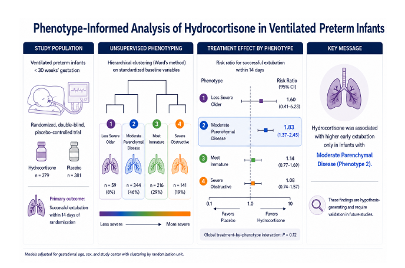

# Baseline Phenotypes and Short-Term Respiratory Outcomes After Hydrocortisone in Ventilated Extremely Preterm Infants

  

## Overview
Bronchopulmonary dysplasia (BPD) remains a major cause of morbidity in extremely preterm infants. Hydrocortisone is frequently used to facilitate extubation, but randomized trials have shown inconsistent benefits, suggesting potential heterogeneity in treatment response.

## Objective
To identify clinically relevant baseline phenotypes in ventilator-dependent preterm infants and evaluate whether outcomes and associations with hydrocortisone vary across phenotypes.

## Baseline Phenotype Characteristics 
| Phenotype | n infants | Characteristics |
|-----------|-----------|-----------------|
| 1 | 59 | Highest respiratory severity at treatment initiation |
| 2 | 344 | Infants with intermediate maturity and moderate respiratory disease |
| 3 | 216 | Most immature infants and was distinguished by lower Apgar scores and substantial ventilatory support requirements |
| 4 | 141 | Most mature infants with the lowest baseline respiratory severity and highest birth weights |
