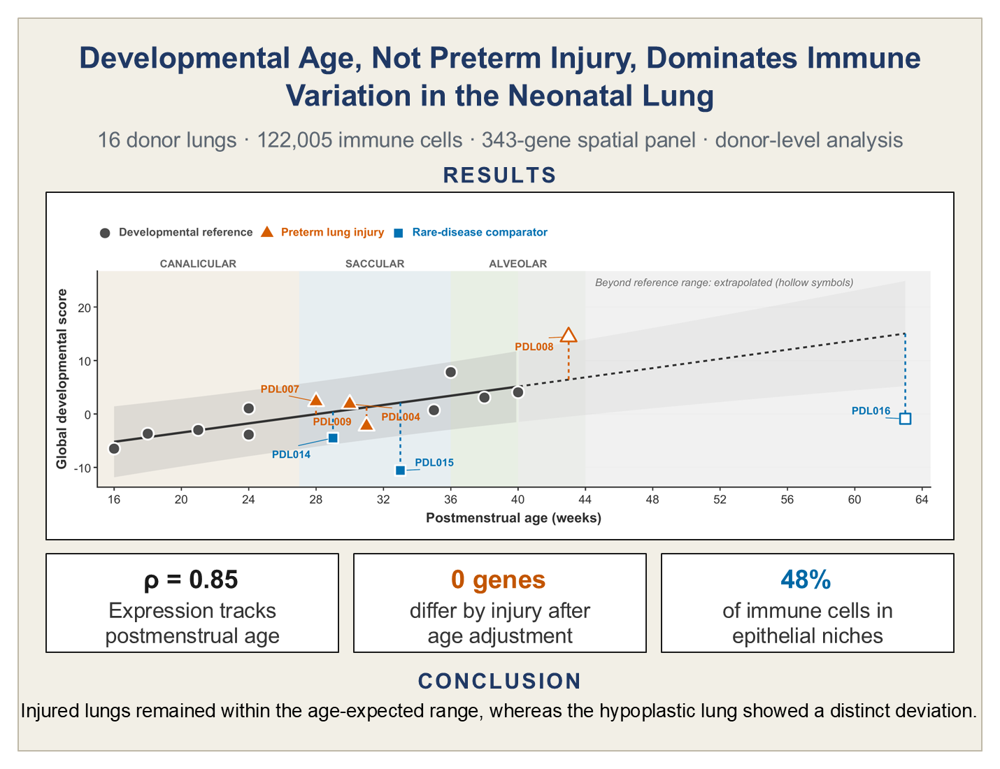

# Developmental and Injury-Associated Variation in the Neonatal Pulmonary Immune Compartment. A Donor-Level Spatial Transcriptomic Analysis

  

## Overview
This project investigates how developmental age and lung injury shape immune cell transcriptional profiles in the developing human lung using imaging-based spatial transcriptomic data from 16 donors and 122,005 immune cells. Using donor-level pseudobulk analysis, principal component analysis, and spatial characterization, we examined associations with postmenstrual age (PMA), assessed potential transcript spillover from neighboring non-immune cells, and evaluated whether preterm lung injury was associated with transcriptional, compositional, or spatial variation beyond developmental expectations. Developmental age was the dominant measured correlate of immune variation, while no independent association with lung injury was detected in this cohort. These findings highlight the importance of accounting for developmental maturity when investigating immune biology in the preterm lung.

## Cohort Characteristics
